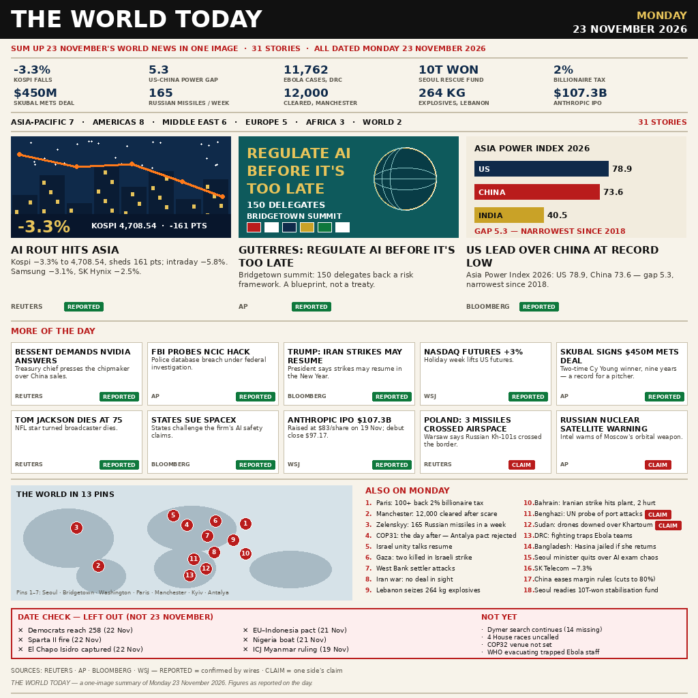

# THE WORLD TODAY — Monday 23 November 2026

[](https://make.fun/bounty/news-image-20261123?utm_source=github&utm_medium=readme&utm_campaign=news-image-20261123)
[](https://make.fun/bounty/news-image-20261123?utm_source=github&utm_medium=readme&utm_campaign=news-image-20261123)
[](https://make.fun/bounty/news-image-20261123?utm_source=github&utm_medium=readme&utm_campaign=news-image-20261123)

A one-image summary of the world's news on Monday 23 November 2026 — 31 stories
in a single front page: three big hero scenes (the AI rout in Asia, Guterres on
regulating AI, and the US lead over China at a record low), ten cards, a
13-pin world map, an 18-item ALSO list, and a DATE CHECK box that keeps
yesterday's news out.



## How it is built

- `draw.py` — renders `entry.png` (1024×1024) with PIL.
- `main.py` — stdlib-only entry point. It validates the bundled PNG
  (signature, IHDR 1024×1024, per-chunk CRCs, size) and copies it
  byte-for-byte to `$MAKEFUN_OUTPUT_DIR/entry.png`. Run it with:

```sh
MAKEFUN_OUTPUT_DIR=out python3 -P -s main.py
```

## Stories

Heroes: Kospi −3.3% to 4,708.54 · Guterres: regulate AI before it's too late
(Bridgetown, 150 delegates) · Asia Power Index 2026: US 78.9, China 73.6,
gap 5.3 — narrowest since 2018. Plus 10 cards and 18 ALSO items, all dated
23 November 2026. Items dated 19–22 November appear only in the red
DATE CHECK box, never as stories.
